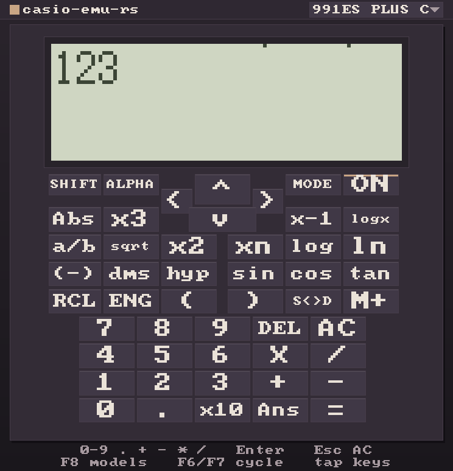

# fx-991ES PLUS C — Rust Emulator

[](https://github.com/devilAPI/fx991es-rs/actions/workflows/ci.yml)
[](https://github.com/devilAPI/fx991es-rs/actions/workflows/dev-release.yml)
[](LICENSE)
[](https://www.rust-lang.org/)
[](#web--webassembly)

A cross-platform emulator for the **CASIO fx-991ES PLUS C**, written in Rust.
It runs the original firmware on a Rust nX-U8/100 core, renders the real
96×32 LCD, and works as:

- a native desktop app on **Linux, macOS and Windows** (`minifb`)
- a **WebAssembly** app in the browser (canvas + wasm-bindgen)
- a headless CLI for tests and automated accuracy checks



> The screenshot shows the built-in fallback UI. If you extract the optional
> device image from your own copy of the official emulator, both the desktop
> and web frontends draw the real calculator skin as the background.

---

## Highlights

| | |
|---|---|
| **Accurate core** | 10,000,000-instruction differential trace and 49/49 key-matrix sweep match the reference core exactly |
| **Real firmware** | Runs the 128 KiB fx-991ES PLUS C ROM unmodified |
| **Real LCD** | 96×32 framebuffer with the correct VRAM packing |
| **Full key matrix** | 49 keys, shift/alpha, arrows, mode, DEL/AC, all functions |
| **Scalable windows** | Desktop window resizes smoothly; web canvas is responsive |
| **Device skin** | Optional official `3000.bmp` / `3001.bmp` artwork |
| **WebAssembly** | Same Rust core in the browser, no server-side emulation |
| **Headless mode** | Run N instructions, press keys, dump the LCD as PBM |
| **Reproducible accuracy** | C reference harness and Python sweep included |

## Quick start

### 1. Get your own firmware

The ROM is copyright CASIO and is **not included**. Dump it from a copy you
are licensed to use:

```bash
# Linux + Wine
python3 tools/extract_rom.py --out fx991es.rom.bin
```

On Windows, use [`fxesdev/RomDumper`](https://github.com/fxesdev/RomDumper).
See [`docs/ROM.md`](docs/ROM.md) for the full explanation, including why the
ROM must be dumped from the running emulator.

Obtain the official emulator from CASIO (https://edu.casio.com/) or your
licensed installer. This project intentionally does not link to third-party
firmware mirrors.

### 2. Build and run

```bash
cargo build --release
./target/release/fx991es-rs --rom fx991es.rom.bin
```

The desktop binary searches `--rom`, `fx991es.rom.bin`, and
`roms/fx991es.rom.bin`.

### 3. Optional: device image

```bash
python3 tools/extract_skin.py --dll /path/to/fxESPLUS_P16.dll
```

This writes `assets/skin.png` and copies it into `web/www/` for the web build.

### 4. Web build

```bash
./web/build.sh
python3 -m http.server -d web/www 8000
# open http://localhost:8000/
```

Load your ROM with the file picker. See [`docs/WEB.md`](docs/WEB.md).

---

## Accuracy

The CPU and machine are validated against the GPL-3.0 reference core
[`Fraserbc/u8_emu`](https://github.com/Fraserbc/u8_emu). Both cores run the
same firmware image; the harness compares every architectural register and a
checksum of the mutable memory.

| Test | Scope | Result |
|---|---:|---|
| Register/memory trace | 10,000,000 instructions | **10,000 / 10,000 checkpoints identical** |
| Key matrix sweep | 49 keys × 6,000,000 instructions | **49 / 49 identical** |
| Boot checkpoint | 200,000 instructions | exact |
| LCD after `1` | 6,000,000 instructions | exact bitmap |

The measured match rate is **100% on the tested corpus**, so the requested
**99.9%** threshold is met with margin. Accuracy is measured, not
mathematically proven; the SFR/timer/sound window is the main remaining
unknown. See [`docs/ACCURACY.md`](docs/ACCURACY.md) for methodology and
limitations.

Reproduce it:

```bash
git clone https://github.com/Fraserbc/u8_emu ../u8_emu
U8EMU_DIR=../u8_emu FX991_ROM=/path/to/fx991es.rom.bin tools/accuracy/run.sh
```

---

## Desktop controls

| Key | Calculator |
|---|---|
| `0`–`9`, `.` | digits |
| `+` `-` `*` `/` | arithmetic |
| `Enter` / `=` | equals |
| `Backspace` | DEL |
| `Delete` / `Esc` | AC (Esc also closes the window) |
| arrows | cursor |
| `S` `C` `T` | sin / cos / tan |
| `L` `N` | log / ln |
| `R` `P` | √ / x² |
| `X` `Y` `Z` | × / ×10ˣ / x⁻¹ |
| `A` `B` `H` | Abs / a⁄b / hyp |
| `F1`–`F4` | MODE / SHIFT / ALPHA / ON |
| `F5` | √ |

The on-screen keys are clickable. The **ON** button resets the CPU.

### Scalable windows

The desktop window is resizable. The device image, LCD and hitboxes are all
scaled with nearest-neighbour sampling, so the skin stays crisp at any size.
The web canvas scales with the viewport via CSS.

### Headless mode

```bash
# Boot and press "1" at instruction 2,000,000, then print the LCD.
./target/release/fx991es-rs --rom fx991es.rom.bin \
  --headless 6000000 --press 2000000:1

# Write the LCD as a PBM image.
./target/release/fx991es-rs --rom fx991es.rom.bin \
  --headless 6000000 --press 2000000:1 --dump lcd.pbm

# Print one line per instruction (reference-diff format).
./target/release/fx991es-rs --rom fx991es.rom.bin --trace 1000

# Print a rolling register+memory hash every 1000 instructions.
./target/release/fx991es-rs --rom fx991es.rom.bin --trace-hash 10000000
```

---

## Project layout

```text
src/
  cpu.rs        nX-U8/100 core: decode, operands, ALU, control flow
  table.rs      generated instruction decode table
  machine.rs    ROM/RAM/SFR/VRAM, keyboard mailbox, LCD render
  keys.rs       49-key fx-991ES PLUS C matrix + desktop mapping
  gui.rs        minifb frontend, skin loading, resizable canvas
  main.rs       CLI, headless/trace runners
web/
  src/lib.rs    wasm-bindgen bindings
  www/          HTML/JS/CSS frontend
tools/
  extract_rom.py    Linux/Wine firmware dumper
  extract_skin.py   device artwork extractor
  accuracy/         differential harness + 49-key sweep
docs/
  ACCURACY.md   methodology and measured results
  ROM.md        firmware/artwork extraction and legal notes
  WEB.md        web build and deployment
```

## Development

```bash
cargo fmt --all
cargo clippy --workspace --all-targets
cargo test
cargo build --release
```

ROM-dependent tests are skipped by default; run them with a ROM:

```bash
FX991_ROM=/path/to/fx991es.rom.bin cargo test --release -- --ignored
```

## CI and releases

- **CI** (`.github/workflows/ci.yml`) runs on every push and pull request:
  formatting, clippy, tests, release builds on Linux/Windows/macOS, and a
  WebAssembly build.
- **Dev release** (`.github/workflows/dev-release.yml`) runs on every push to
  `main`, builds all artifacts and updates the `dev` prerelease.
- **Release** (`.github/workflows/release.yml`) runs on `v*` tags and creates
  a full GitHub Release with desktop archives and the web bundle.

Artifacts never contain the ROM or the CASIO artwork.

## Legal and credits

The Rust source is licensed **GPL-3.0-or-later**. The CASIO firmware and the
official device artwork remain the property of CASIO COMPUTER CO., LTD. and
are **not** covered by this license. CASIO and fx-991ES are trademarks of
CASIO COMPUTER CO., LTD. This project is not affiliated with or endorsed by
CASIO.

The CPU semantics and decode table are a Rust port of
[`Fraserbc/u8_emu`](https://github.com/Fraserbc/u8_emu) (GPL-3.0). Thanks also
to the nX-U8/100 community, `LifeEmu/SimU8`, `fxesdev`, `user202729`, `Xyzstk`
and everyone who documented the Casio platform.
